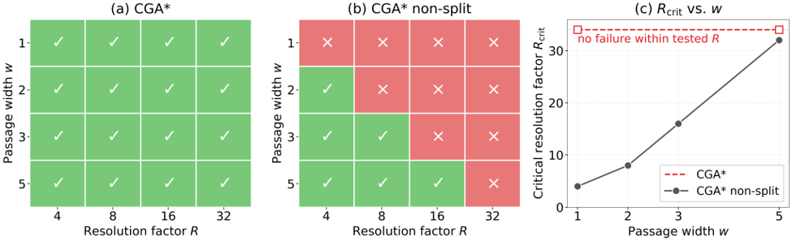
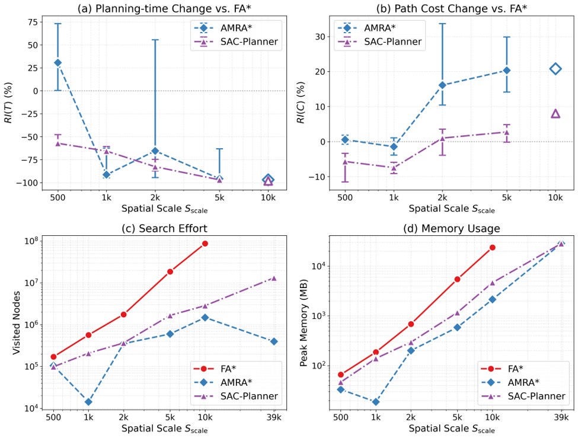

# SAC-Planner

Scale-adaptive hierarchical path planning with corridor-based local refinement
for off-road navigation on large terrain cost maps.

SAC-Planner combines hierarchical guidance generation with complete-route
corridor refinement.

## How it works

**SA-Planner.** For each planning region, SA-Planner selects a resolution factor
using its spatial scale and an empirical runtime model, subject to an aggregation
limit. It repeatedly extracts local submaps along the current path and refines
individual segments until the stopping criteria are met, producing a complete
start-to-goal guidance path.

**CGA\*.** CGA\* performs coarse search within SA-Planner. It represents
block-local eight-connected traversable components as separate graph vertices and
connects them through valid original-grid adjacencies. This preserves
original-grid reachability, including narrow-passage connectivity, in the coarse
graph.

**CB-Refiner.** Using the guidance path produced by SA-Planner, CB-Refiner
constructs a two-dimensional corridor and replans the entire route at the original
resolution within it. Intermediate guidance waypoints are not fixed constraints,
allowing terrain costs and connections across segment boundaries to be jointly
re-evaluated. The corridor is progressively widened if the search fails.

---

## Narrow-passage connectivity



**Fig. 14 (from the manuscript).** Synthetic narrow-passage search outcomes. (a) CGA\*; (b) CGA\* non-split; (c) first observed failure factor versus passage width. Check marks and crosses indicate successful and failed coarse searches, respectively. The dashed red indicator denotes no observed failure for CGA\* among the tested factors and does not represent a measured critical value.

*Success refers to the coarse-graph search only; it is not the success rate of final route planning.*

## Scale adaptability



**Fig. 16 (from the manuscript).** Scale adaptability. (a) Median paired planning-time changes relative to FA\*. (b) Median paired composite-cost changes relative to FA\*. (c) Median visited-vertex counts. (d) Median peak memory. Error bars in (a) and (b) indicate bootstrap 95% confidence intervals; open markers denote the single matched pair at scale 10000. Panels (c) and (d) summarize successful runs.

---

## Demonstration

`demo/demo_component_graph.py` runs the component-graph A* search on a synthetic
192 x 192 map with a wall, a single narrow opening, and isolated nearby
obstacles. Flat synthetic costs keep the example focused on connectivity. This
demonstration illustrates block-local component decomposition, original-grid
adjacency, and A* search on the resulting component graph.
SA-Planner's adaptive resolution selection and CB-Refiner are not included.

```bash
python -m pip install -r requirements.txt
python demo/demo_component_graph.py --R 10
```

The script reports search success, visited components, and grid-route checks.
After A* selects a component sequence, the demo recovers a traversable grid route
within the selected components for visualization. The route starts and ends at
the marked cells and is checked against obstacles. This display reconstruction
is not CB-Refiner. The output
`demo_component_graph.png` shows the full route and a passage detail.

The bundled map is synthetic demonstration data, not an experimental dataset.
This focused example exercises the coarse component-graph search only; it is not
a reproduction of the manuscript's full planning pipeline or experiments.

## Status

Currently available: a project overview, selected experimental result
visualizations (Figs. 14 and 16 of the manuscript), and the component-graph
demonstration.

Not yet released: the full SAC-Planner implementation and the scripts needed to
reproduce the experiments.

## Contact

Yiguang Gong — yiguang-gong@nuist.edu.cn
Nanjing University of Information Science and Technology
